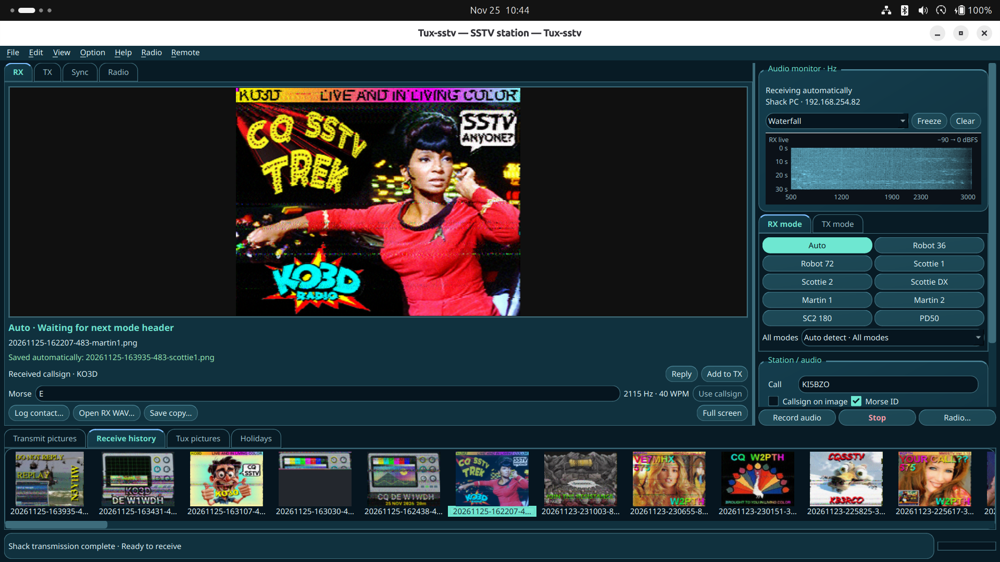
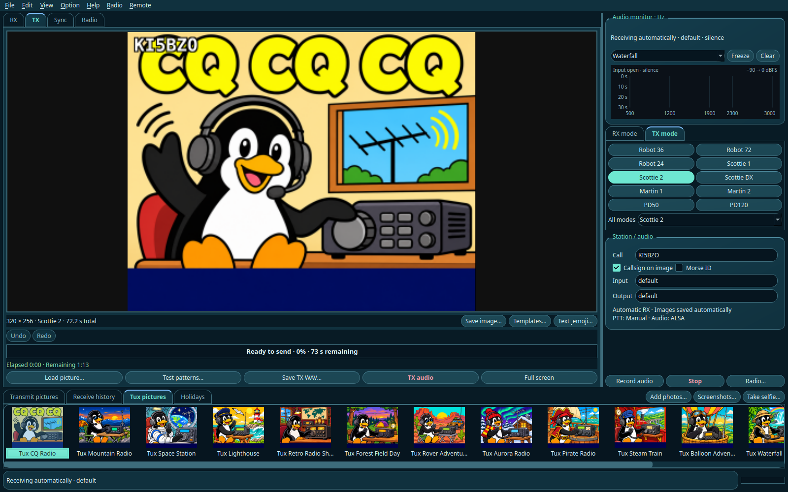
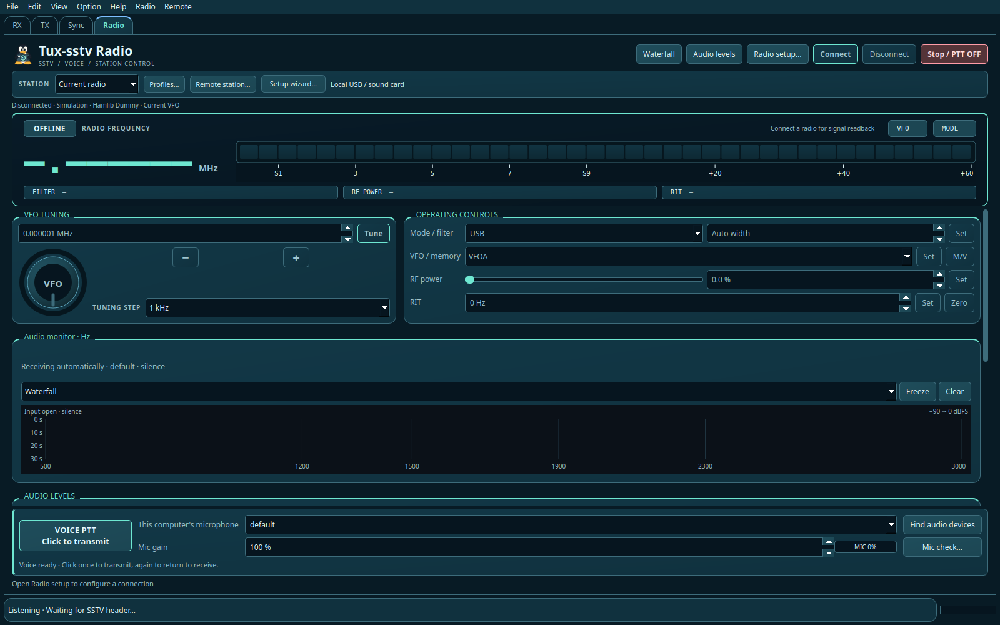
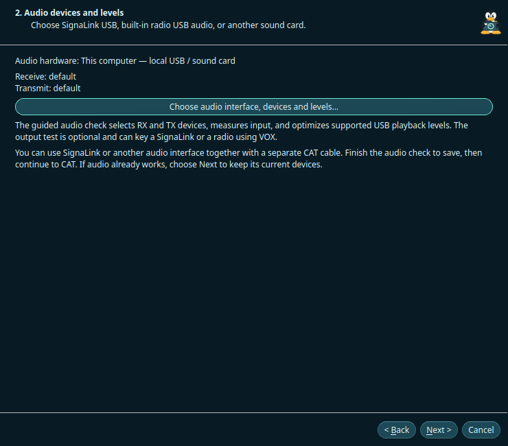
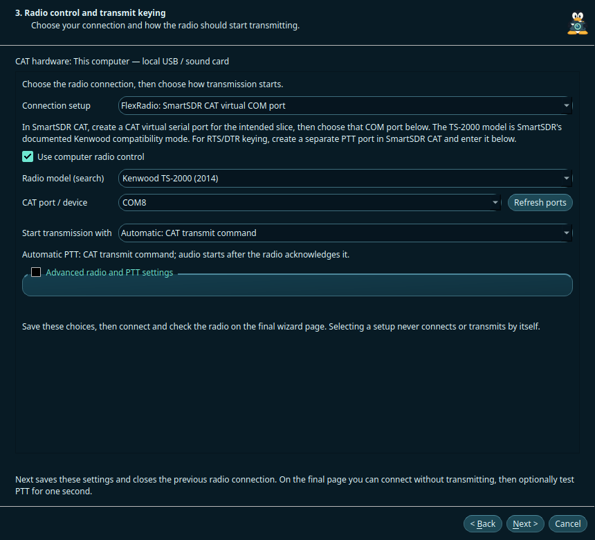
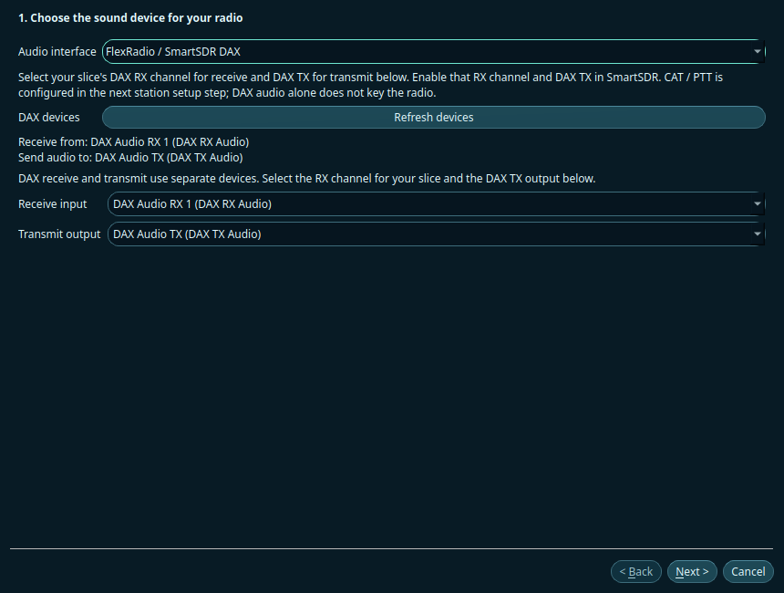

# Tux-sstv for Windows and Linux

Send and receive slow-scan television pictures over amateur radio with Tux-sstv, developed by **Eric Richards, KI5BZO**.

## Downloads

Linux **1.15.0** includes the new guided setup wizard. The Windows **1.16.0**
installer is being built and tested in [GitHub Actions](https://github.com/ericrichards420-art/Tux-sstv/actions/runs/45907199013);
Windows **1.15.3** remains available below until that build passes.

| Platform | Version | Download |
| --- | --- | --- |
| Windows 10 (1809+) / Windows 11, 64-bit | 1.15.3 | [Download Windows installer](https://github.com/ericrichards420-art/Tux-sstv/releases/download/v1.15.3/Tux-sstv-1.15.3-windows-x64-setup.exe) |
| Ubuntu 26.04, 64-bit Intel/AMD | 1.15.0 | [Download Linux .deb](https://github.com/ericrichards420-art/Tux-sstv/releases/download/linux-v1.15.0/tux-sstv_1.15.0-1.ubuntu26.04_amd64.deb) |

### Windows installation

1. Run the downloaded installer.
2. Open **Tux-sstv** from the Windows Start menu. The installer also offers a desktop shortcut.
3. Use the **Setup wizard** to select your audio interface and configure radio control or a remote connection.

Requires **64-bit Windows 10, version 1809 or newer, or Windows 11**. The installer includes the application and its runtime dependencies; you do not need a compiler or a separate Qt installation.

### Linux installation

The Linux `.deb` is built for **Ubuntu 26.04 on 64-bit Intel/AMD PCs (amd64)**. It requires the runtime library and emoji-font versions available for that Ubuntu release; it is not a universal package for every Linux distribution.

After downloading the package, open a terminal in its download folder and run:

```bash
sudo apt install ./tux-sstv_1.15.0-1.ubuntu26.04_amd64.deb
```

APT installs the required dependencies. Open **Tux-sstv** from the application menu, or run `tux-sstv`, then use the **Setup wizard** to choose audio, CAT, and remote settings.

## Features

- 43 SSTV modes, with automatic reception and mode detection.
- Live waterfall and received-image display.
- Image preparation with text, emoji, templates, and Tux artwork.
- SignaLink USB, radio USB sound cards, and other audio interfaces.
- Hamlib CAT/PTT control, including a separate CAT cable alongside your audio interface.
- Remote shack operation over Wi-Fi, with radio audio and microphone support.
- Radio profiles for saving different station configurations.

<!-- TUX-SSTV-SCREENSHOTS-BEGIN -->
## Screenshots

Linux interface shown below. Click a picture to view it at full size.

| Receive an SSTV image | Prepare a picture to transmit |
| --- | --- |
| [](docs/screenshots/receive-over-the-air.png) | [](docs/screenshots/transmit-and-tux-gallery.png) |
| **Radio controls** | **Guided station setup** |
| [](docs/screenshots/radio-console.png) | [](docs/screenshots/setup-wizard.png) |

[Screenshot details](docs/screenshots/README.md)
<!-- TUX-SSTV-SCREENSHOTS-END -->

## New guided setup: Linux 1.15.0 / Windows 1.16.0

- Choose a radio USB/CAT, SignaLink, FlexRadio, rigctld, or manual setup preset.
- Select audio and CAT independently, with an explicit choice of CAT, RTS/DTR, or audio-operated PTT.
- Configure Flex SmartSDR CAT virtual COM separately from native SmartSDR network control.
- Choose DAX receive and transmit endpoints with clear device labels.
- Review the configuration, connect without transmitting, and optionally test PTT for one second.

Read the [setup guide](linux/docs/SETUP_GUIDE.md). The new wizard has automated regression coverage; Flex hardware and on-air validation are still needed.

| Flex SmartSDR CAT preset | DAX audio selection |
| --- | --- |
| [](docs/screenshots/setup-flex-cat.png) | [](docs/screenshots/setup-dax-audio.png) |

Setup previews use example devices and a disconnected radio.

## SignaLink with a separate CAT cable

In the new wizard, select **SignaLink USB** and its sound device, often named **USB AUDIO CODEC**. Choose the **SignaLink + CAT** preset for radio control, then select the radio model, CAT port, and baud rate. The keying choice explicitly identifies audio-operated PTT; CAT controls frequency and mode independently. This applies to any compatible radio.

In older published installers, the equivalent CAT option is **Use audio interface + separate CAT cable**.

## Support

Use the [Issues page](https://github.com/ericrichards420-art/Tux-sstv/issues) to report a problem. Include your Tux-sstv version, operating system and version, radio model, audio interface, and what happened.

Created and developed by **Eric Richards, KI5BZO**.

<!-- TUX-SSTV-SOURCE-BEGIN -->
## Source code and compatibility builds

The current platform source snapshots are available here:

- [Linux 1.15.0 source](linux/)
- [Windows 1.16.0 source](windows/)
- [Build instructions](BUILDING.md)
- [Project license](LICENSE.md)

Original project developer: **Eric Richards, KI5BZO**.

The source is provided for **personal compilation and compatibility adjustments
for Linux and Windows only**. Redistributing source or compiled builds requires
Eric Richards's separate written permission. Preserve the original project
credit and applicable third-party notices. See the license for the precise
permissions and conditions.

For improvement proposals or other permissions, contact
**ericrichards420@gmail.com**. See [CONTRIBUTING.md](CONTRIBUTING.md).
<!-- TUX-SSTV-SOURCE-END -->
