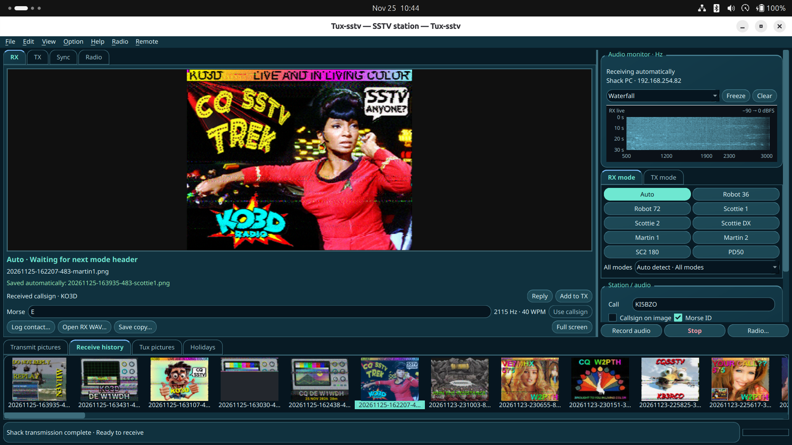
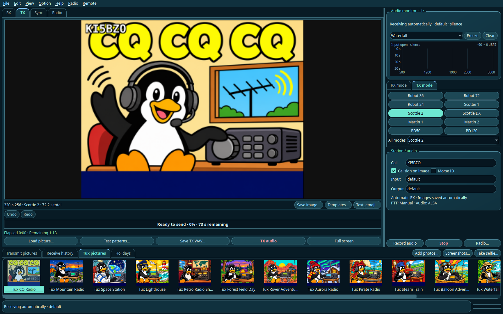
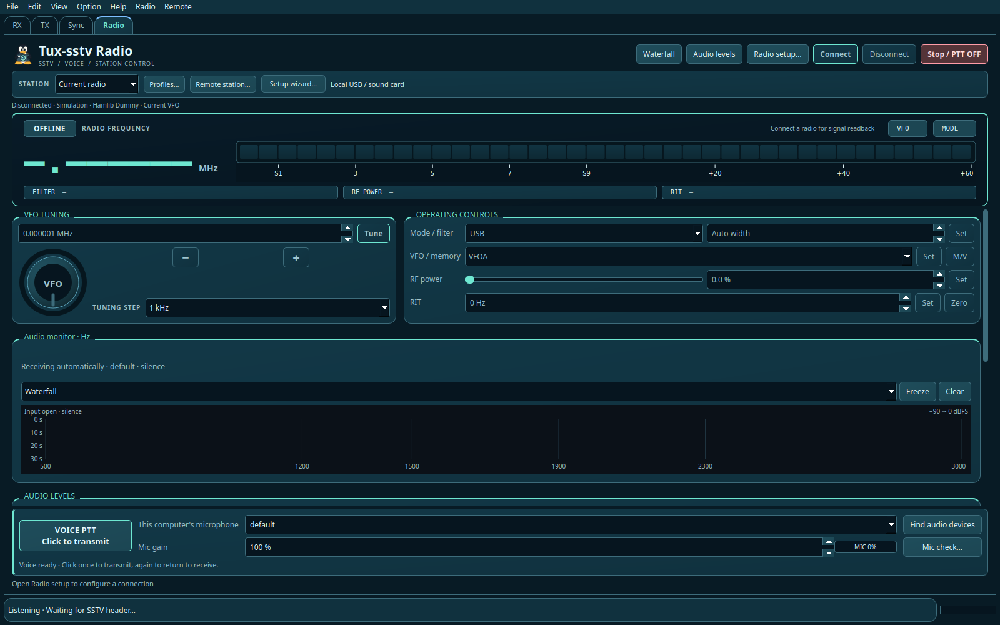
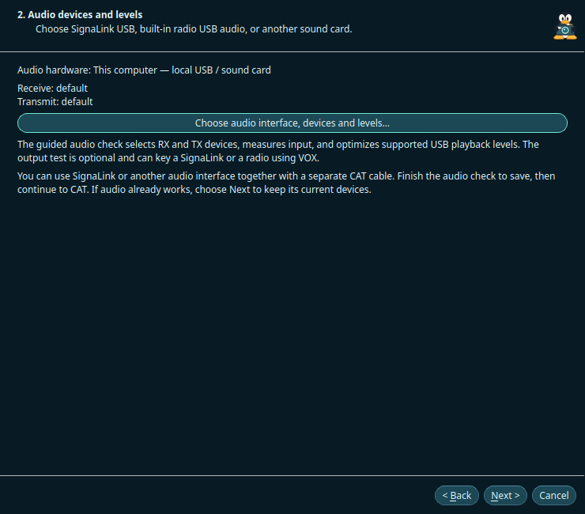

# Tux-sstv screenshots

These are captures of the Linux interface, added November 25, 2026.
Click an image below for the original PNG. The original three documentation captures
use the Linux 1.14.3 application UI with an isolated example profile.
The guided setup previews below were added November 26 using Linux 1.15.0.

## Receiving over the air

Eric's saved screenshot from November 25, 2026 shows an SSTV image received
over the air through the remote shack connection, automatic mode detection,
the waterfall, and received-picture history. This is the original screenshot,
including the desktop panel. The received picture is another station's image;
its callsign is not a Tux-sstv developer credit or an endorsement.

## Preparing a picture to transmit

The TX tab shows a bundled Tux picture, the KI5BZO callsign overlay,
Scottie 2 mode selection, transmit controls, and the built-in picture gallery.
This capture shows picture preparation before transmission.

## Radio controls

The Radio tab groups station profiles, frequency and VFO controls, radio
mode, RF power, RIT, audio monitoring, microphone level, and voice PTT.
The capture shows the disconnected state; it contains no live CAT readings.

## Setup wizard

The audio step explains SignaLink USB, built-in radio USB sound cards,
other audio interfaces, receive/transmit levels, and using a separate CAT
cable. The full station wizard also guides local/remote connection and CAT
setup. This capture shows the audio overview before device selection.

## New guided radio setup

These previews show the actual Linux 1.15.0 interface with example profiles,
example audio endpoints, and a disconnected radio. They show configuration
choices; they are not evidence of a FlexRadio hardware or on-air test.

- [Flex SmartSDR CAT virtual COM preset](setup-flex-cat.png)
- [Separate DAX receive and transmit devices](setup-dax-audio.png)
- [SignaLink audio-operated PTT with separate CAT](setup-signalink.png)
- [Configuration review and explicit test controls](setup-review.png)

Tux-sstv was developed by **Eric Richards, KI5BZO**.
See the [project license](../../LICENSE.md) and the platform-specific
third-party notices for the applicable source and component terms.
